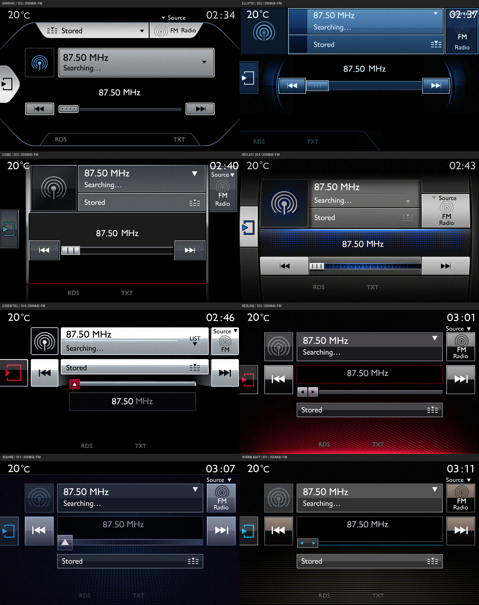

# SMEG+ Research and Emulation

A reverse-engineering and emulation workbench for Peugeot/Citroën SMEG+ firmware **SMEG5.43.A.R2**, developed around the **MPC5121E/e300 PowerPC** platform and **VxWorks 6.7**.

The project provides a custom QEMU machine, a host graphics bridge, firmware inspection and packaging tools, and experiments with the INT_E application profile and native theme resources. Original firmware, vehicle databases, cryptographic key material and prepared installation media are not distributed.

## Documentation

- [Emulation: build, boot and graphics](docs/EMULATION.md)
- [Reverse engineering: platform, update integrity and INT_E](docs/REVERSE_ENGINEERING.md)
- [Deployment: theme packages, validation and recovery limits](docs/DEPLOYMENT.md)
- [Third-party sources and licenses](THIRD_PARTY_NOTICES.md)
- [Contributing and reporting results](CONTRIBUTING.md)

## Demonstrated results

| Area | Result | Scope |
| --- | --- | --- |
| Platform | Big-endian PowerPC modules and VxWorks 6.7 BSP identified | Supplied firmware analysis |
| Emulation | Kernel, filesystems and native application UI run under QEMU | Synthetic board and peripheral models |
| Graphics | Native drawing calls rendered through a host software graphics bridge | Original MBX GPU command execution remains incomplete |
| Themes | Eight themes listed after native USB installation and USB-free cold boot | Emulator verified; expanded physical installation remains unverified |
| INT_E Internet UI | Eligibility and policy experiments expose Internet screens with NAV resources | A working phone network connection or external-network browser page load is not established |



*Emulator captures, not photographs of a modified vehicle. ELLIPTIC and CUBIC retain known clock/header overlaps. Screenshots illustrate proprietary UI and are not reusable theme assets.*

## Methodology

1. **Establish evidence.** Inspect original package hashes, PowerPC instructions, exported symbols, update manifests and resource formats. Distinguish file offsets, runtime addresses and NAND destinations.
2. **Build the platform model.** Implement the MPC5121E-oriented memory map and the NFC, DMA, interrupt, display, MCU and input behaviors required by the application. Record synthetic hardware assumptions separately from measured evidence.
3. **Use an isolated sandbox.** Boot copied media, collect serial traces, compare database rows and resource hashes, and verify persistent changes with a USB-free reboot.
4. **Delegate bounded analysis.** Autonomous AI agents assisted with source analysis, implementation, test generation and independent review. Generated code and inferred hardware behavior are checked against reproducible tests and firmware evidence; agent output alone is not validation.
5. **Constrain modifications.** Investigate INT_E profile restrictions in isolated copies before considering deployment. The theme-only installer preserves the selected WARMLIGHT theme and unrelated settings in the tested emulator fixture; Internet and application binary experiments are separate workflows.

## Getting started

Use Linux with a C/C++ toolchain, Python and the QEMU build dependencies listed in [EMULATION.md](docs/EMULATION.md).

```sh
git clone https://github.com/jlfernandes22/SMEG5.43.A.R2.git
cd SMEG5.43.A.R2
python3 -m venv .venv
. .venv/bin/activate
python3 -m pip install -r requirements.txt

git clone --branch v9.2.0 --depth 1 https://github.com/qemu/qemu.git sources/qemu
SMEG_BUILD_JOBS=4 bash emulation/build.sh
```

Building QEMU and running firmware-independent checks do not require a vehicle. Booting the SMEG application requires a legally obtained firmware package and locally generated filesystem images. Historical experiment runners also require their documented private seed images and validation artifacts; cloning this repository does not supply those inputs.

```sh
python3 emulation/test_gles_metadata.py
python3 emulation/test_diu_scanout.py
bash emulation/test_soft_gles.sh
```

The [deployment guide](docs/DEPLOYMENT.md) describes the theme source, CRC/INF generation, native progress display, validation gates and remaining physical constraints. It is not a universal vehicle update or guaranteed recovery procedure.

## Repository layout

```text
docs/                    Technical documentation and historical research notes
emulation/               QEMU machine, device models, graphics bridge and runners
scripts/                 Extraction, analysis, packaging and verification tools
artifacts/screenshots/   Selected, non-personal emulator UI captures
sources.lock.json        Upstream research and build source revisions
```

Build outputs, upstream checkouts, raw NAND images, original car exports, databases and local device configuration remain ignored.

## License and provenance

Project-authored code is distributed under **GPL-2.0-or-later**, except where a file states another license. Third-party notices and licenses remain in their original files; the PowerVR texture decompressor is MIT licensed. See [LICENSE](LICENSE) and [THIRD_PARTY_NOTICES.md](THIRD_PARTY_NOTICES.md).

This is an independent research project, without affiliation with Peugeot, Citroën, Stellantis, Wind River or NXP. Product names identify the systems studied.
